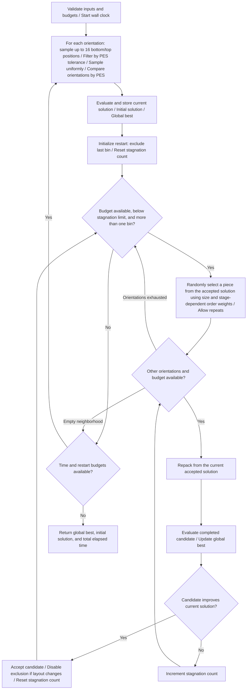

# improved_GRASP control flow

The original GRASP remains unchanged. The new function uses the same required arguments and returns the same 11 values. It adds the optional parameters `rcl_tolerance=0.10`, `random_CA_threshold=5`, `restart_limit=None`, and `no_improvement_limit=None`. The stagnation threshold defaults to the repacking budget for each restart.

Local search uses first improvement: accept a candidate when it improves the current solution, even if it does not improve the global best. Piece selection shares `improve_pieces_selection_ls` with `improved_ILS` and allows repeated random sampling. Weights use the current accepted solution's object sizes and original order, shifting preference from earlier to later pieces as stagnation increases. Once an accepted layout changes, exclusion of the last bin is permanently disabled for that restart. Rejected candidates do not change the flag. Each new construction enables exclusion again. `alpha` is retained for interface compatibility but is not used by this selector.

A new construction starts when consecutive rejected candidates reach `no_improvement_limit` or the per-restart budget is exhausted. Termination no longer depends on a complete neighborhood scan. Local search is skipped for single-bin solutions.

The per-restart budget counts only repacking calls. The time budget includes copying and evaluation. A packing-engine call cannot be interrupted and may overrun the time limit, but its completed result is still considered for the best solution. At least one initial solution is constructed. With only one orientation, neighborhood search ends immediately. Piece selection and packing-position selection use separate NumPy Generators, initialized once per algorithm run with `piece_seed=101` and `position_seed=202`. They advance throughout the run, including restarts. The instance-order seed controls the stored object sequence independently; changing it does not reseed either search stream. Legacy kick randomness remains on the global RNG.

CPU isolation tests execute the real function's control flow with simulated geometry packers and clocks. They do not validate CUDA, collisions, or accessibility.

PES shares `SCH_iter_ls.nesting_evaluation` with `improved_ILS`. The strategy is specified by `SCH_nesting_strategy`, and `_encourage_dbl=True` retains the distance-to-origin term. Local search uses the same `improved_repack` and `bounding_box` candidate type; its position range is still controlled by `selection_range`.

During construction, each fixed orientation uses the lowest and highest nonempty z cross-sections of the accessible feasible region. Endpoints on the four AABB edges provide at most 8 points per face and at most 16 unique points overall. Only extrema are retained even when a cross-section contains at most 25 points. When bottom and top coincide, the slice is processed only once. Each valid position is scored by PES. With the minimum score denoted by `s_min`, the RCL retains positions satisfying `s <= s_min + rcl_tolerance * abs(s_min)`, and one is selected uniformly at random. When the best score is zero, only tied positions are retained, allowing for floating-point roundoff. Out-of-bounds and colliding candidates are still rejected during scoring.

Each orientation returns the actual PES of its sampled position, and the constructor compares orientations using that score. It no longer randomly chooses among the top 5 orientations. This strategy is enabled only during randomized construction; position selection in local search and ILS remains greedy. Set `rcl_tolerance=None` to restore the legacy random sampling among the top k orientations, with `random_CA_threshold` controlling k. The first piece in an empty bin still uses the existing starting position without calculating AFR; its orientation is compared using the unified PES.

Both improved algorithms unify the compatibility parameter `orien_evaluation` with `SCH_nesting_strategy`. Construction uses `unified_pes=True`, so the first piece and newly opened bins also use the same PES for orientation scoring rather than height alone. The local-search acceptance criterion remains the overall packing objective `N - U*`.
