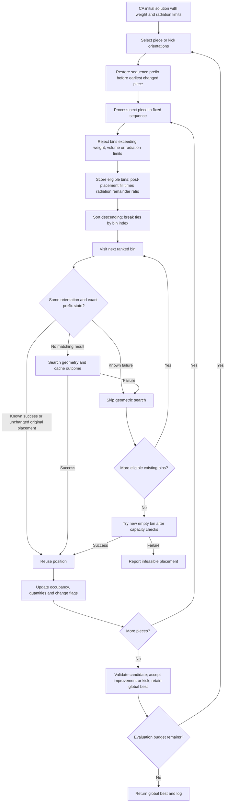

# improved_ILS_weight_radio framework

The framework is independent of existing ILS. Initial CA must obey the same
limits; for constant volume-to-weight factor, weight capacity is converted
into an equivalent CA volume limit. The ranked repacker checks both limits.
Original piece shapes, radio observations and search settings remain immutable
within a cache lifetime. Failure reuse requires an identical piece, orientation,
bin index, processed prefix and search configuration. No bin-index-before-original
shortcut is used. Matching successes are reused only at their ranked turn.

The default selector is a volume/stage-weighted framework selector; it is not
claimed identical to existing improved_ILS. An injectable selector allows a
future matched-policy comparison. All pieces are eligible. Kicks change about
half the orientations, use the ranked repacker, and retain the global best.
Cache size and prefix-key overhead have not yet been optimized or benchmarked.

CPU tests cover ranking, untried unchanged bins, cache failures, invalidation,
weight constraints, kick behavior and the evaluation budget. The real chess
smoke test loads its stored radiation proxy values without changing them.
Its per-bin limits are explicit experimental choices, not physical calibration.

## Shared post-placement score update (2026-10-15)

The score is now `((current_volume + piece_volume) / bin_volume) * ((max_radio - current_radio - piece_radio) / max_radio)`. The event field `filling_rate` denotes the post-placement rate; `filling_rate_before` and `filling_rate_after` are both logged. All three public improved controllers in the main repository use the same ranked CA/LS/kick adapter by default. Use `radio_priority=False` for the prior first-fit controller path. Frozen experiment sources and previously submitted HPC bundles are unchanged.
